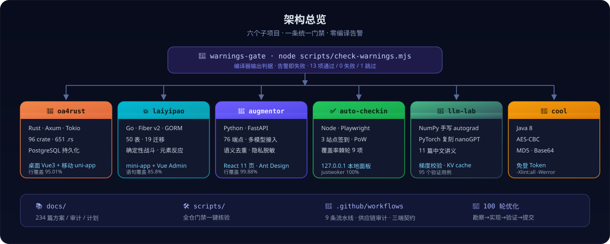
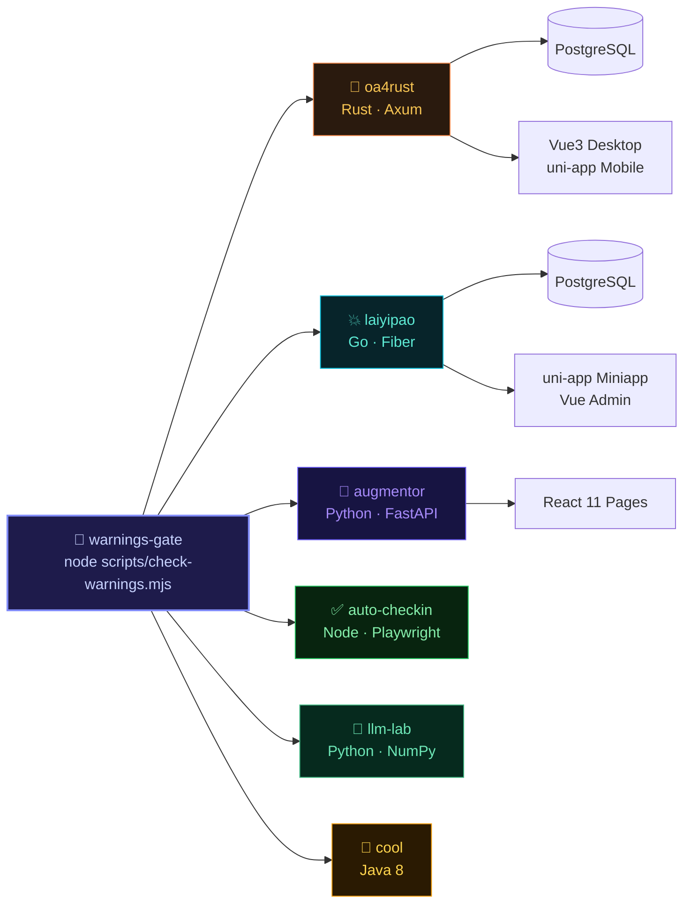

<div align="center">



<br/>

### 一个装着若干「不那么玩具」的玩具箱

**从 Rust 重写的企业级 OA 后端，到塔防元素反应小程序游戏、AI 训练数据增强工具、自动签到面板、免登 Token 生成器——**
**几个互相独立、各自能跑的实验性项目，共处一个 monorepo。**

<br/>

<a href="#projects"><kbd>📦</kbd> 项目</a>
&nbsp;·&nbsp;
<a href="#metrics"><kbd>📊</kbd> 指标</a>
&nbsp;·&nbsp;
<a href="#architecture"><kbd>🏗️</kbd> 架构</a>
&nbsp;·&nbsp;
<a href="#gates"><kbd>🚦</kbd> 门禁</a>
&nbsp;·&nbsp;
<a href="#rounds"><kbd>🔁</kbd> 优化</a>
&nbsp;·&nbsp;
<a href="#quickstart"><kbd>🚀</kbd> 上手</a>

<br/>

[](https://www.rust-lang.org/)
[](https://go.dev/)
[](https://vuejs.org/)
[](https://www.typescriptlang.org/)
[](https://python.org/)
[](https://nodejs.org/)
[](https://openjdk.org/)
[](https://www.postgresql.org/)
[](LICENSE)

</div>

---

<a id="projects"></a>

## 📦 里面有什么

这是一个多语言、多技术栈的 monorepo。每个子项目自成一体，可单独构建、单独运行、单独测试。

| 子项目 | 一句话 | 技术栈 | 规模 |
| --- | --- | --- | --- |
| 🦀 **[oa4rust](oa4rust/)** | Rust 重写的企业 OA 系统 | Rust · Axum · Vue3 · uni-app · PostgreSQL | 96 crate · 651 `.rs` |
| 💥 **[laiyipao](laiyipao/)** | 塔防 + 元素反应小程序游戏 | Go · Fiber · uni-app · Vue3 · PostgreSQL | 289 `.go` · 50 表 |
| 🧪 **[augmentor](augmentor/)** | AI 训练数据增强工具 v3.0 | Python · FastAPI · React · Ant Design | 76 端点 · 10174 单测 |
| ✅ **[auto-checkin](auto-checkin/)** | 大模型公益站自动签到面板 | Node · Playwright · Express | 3 站点 · 9 项棘轮 |
| 🧠 **[llm-lab](llm-lab/)** | 从零学大模型训练 | Python · NumPy · PyTorch | 11 讲义 · 95 用例 |
| 🔐 **[cool](cool/)** | Cool College OA 免登 Token 生成 | Java · AES/MD5 | — |

---

<a id="metrics"></a>

## 📊 质量仪表盘



> 以上均为**实测值**，非宣称值。口径逐项标注：oa4rust 为 shared crate 行覆盖率（`cargo llvm-cov`），augmentor 为核心包行覆盖率（`coverage.xml`），laiyipao 为全包合并 profile 语句覆盖率（`go tool cover -func`）。

<div align="center">

| 指标 | 数值 | 证据来源 |
| :-- | :--: | :-- |
| Rust · oa4rust 行覆盖 | **95.01%** | 100 轮优化台账 · 第 25 轮 |
| Python · augmentor 行覆盖 | **99.88%** | `augmentor/coverage.xml` |
| Go · laiyipao 语句覆盖 | **85.8%** | `docs/laiyipao/audits/coverage-2026-10-28.md` |
| augmentor 单测 | **10174 passed / 0 failed** | 100 轮优化台账 · 第 20 轮 |
| 编译告警门禁 | **13 通过 / 0 失败 / 1 跳过** | `node scripts/check-warnings.mjs` |
| 全仓提交 | **3404** | `git rev-list --count HEAD` |
| 优化轮次 | **26 / 100** | `docs/plans/optimization-rounds-100.md` |

</div>

---

<a id="architecture"></a>

## 🏗️ 架构总览





---

<a id="gates"></a>

## 🚦 编译告警零容忍

本仓库的门禁是**所有子项目编译 0 告警**。不是"尽量少"，是 0：出现一条告警即视为构建失败。

判据是**编译器自己的输出**，而不是"命令退出码为 0"——很多工具链的告警不改变退出码（Vite / Rollup / lightningcss / Python 的 `SyntaxWarning` 都是这样），所以每项检查除了要求 exit 0，还要对输出做正则匹配，命中即失败。

```bash
node scripts/check-warnings.mjs          # 全跑
node scripts/check-warnings.mjs --list   # 列出检查项
node scripts/check-warnings.mjs --only rust,admin
```

各子项目自身也把"告警=错误"写进了配置，所以直接跑各自的构建命令同样会失败：

| 子项目 | 门禁 |
|--------|------|
| oa4rust 后端（Rust） | `Cargo.toml` 的 `[workspace.lints.rust] warnings = "deny"`（96 个 crate 均 `[lints] workspace = true`），CI 另有 `cargo clippy -- -D warnings` |
| oa4rust desktop / mobile | CI 构建后由 `scripts/assert-no-warnings.sh` 断言日志无 `(!)` / `[lightningcss` / `warning:` |
| laiyipao server（Go） | `go vet` + `gofmt -l`（有输出即失败） |
| laiyipao admin / miniapp | 同上，构建日志断言 |
| augmentor / llm-lab（Python） | `python -W error::SyntaxWarning -m compileall` |
| augmentor/web | `eslint --max-warnings 0` + 构建日志断言 |
| auto-checkin（TS） | `tsc --noEmit` |
| cool（Java） | `javac -Xlint:all -Werror` |

<details>
<summary><b>🔍 14 项检查清单（点击展开）</b></summary>

| # | id | 检查内容 |
|---|---|---|
| 1 | `rust-lints` | oa4rust/backend 全部成员继承 `deny(warnings)` |
| 2 | `rust` | oa4rust/backend（Rust，96 crates） |
| 3 | `desktop` | oa4rust desktop（Vue + Vite） |
| 4 | `mobile` | oa4rust mobile（uni-app H5 + 微信小程序） |
| 5 | `go` | laiyipao/server（Go） |
| 6 | `admin` | laiyipao/admin（Vue + Vite） |
| 7 | `miniapp` | laiyipao/miniapp（uni-app H5） |
| 8 | `auto-checkin` | auto-checkin（TypeScript，typecheck + 测试） |
| 9 | `augmentor-web` | augmentor/web（React + Vite） |
| 10 | `augmentor` | augmentor（Python 字节码编译） |
| 11 | `llm-lab` | llm-lab（Python 字节码编译） |
| 12 | `llm-lab-tests` | llm-lab（pytest 行为面） |
| 13 | `java` | cool（Java，`-Xlint:all -Werror`） |
| 14 | `r7-readonly-cross-check` | oa4rust R7 只读挂写交叉验证（0 疑似含写） |

</details>

> ⚠️ 不要用 `VITE_CONFIG_NATIVE_IGNORE_WARNING` 这类开关压掉告警——那是把门禁关掉，不是修问题。

---

<a id="rounds"></a>

## 🔁 100 轮优化引擎

这个仓库正跑着一条**有台账、可复现、不允许中途糊弄**的优化流水线。每轮 = 勘察 → 实现 → 验证 → 提交 → 推送，全程记账。

**当前进度：26 / 100 轮**

<details>
<summary><b>📖 最近 10 轮台账（点击展开）</b></summary>

| 轮次 | 日期 | 主题 | 验证 |
|---|---|---|---|
| 26 | 2026-10-30 | 全 workspace 测试修复夹具 E23505 竞态（改 `upsert_fixture_person`） | 该 crate 27 绿；**全 workspace 零失败**；门禁 13/0/1 |
| 25 | 2026-10-30 | 可解析但无 host URL 的 fail-fast panic 分支 | shared 329 绿；**行覆盖突破 95%** |
| 24 | 2026-10-30 | oa4rust 前端 bundle 验证（main 41KB，vendor 独立 chunk） | 工程卫生 |
| 23 | 2026-10-30 | 工程卫生：augmentor 启动耗时 234ms + 全仓 TODO 扫描无遗留 | 性能/卫生验证 |
| 22 | 2026-10-30 | C1 终值更新（94.99%）+ augmentor 测试运维要点 | 文档工程 |
| 21 | 2026-10-30 | 计划文档引用轮次台账；augmentor web bundle 分析 | 文档工程 |
| 20 | 2026-10-30 | augmentor 全量零失败确认（棘轮重钉） | **10174 passed / 0 failed** |
| 19 | 2026-10-30 | `create_pool_with_url` 无 host fail-fast panic 分支 | shared 328 绿；94.99% |
| 18 | 2026-10-30 | 安全基线验证（auto-checkin 0 漏洞 / rustsec 例外有效） | 依赖审计通过 |
| 17 | 2026-10-30 | CSRF 回环镜像分支 + 权限判定不可达池 fail-closed | shared 327 绿；**94.99%** |

</details>

> 完整台账：[`docs/plans/optimization-rounds-100.md`](docs/plans/optimization-rounds-100.md)

---

## 📚 各子项目速览

<details>
<summary><b>🦀 oa4rust — Rust 重写的企业 OA 系统</b></summary>

源自 O2OA 的重写，追求更强的性能、内存安全与更低的资源占用。

**架构特点**
- 后端：Axum + Tokio 异步栈，PostgreSQL 持久化，**96 个 crate** 的 Cargo workspace
- 前端：pnpm workspace 统一管理桌面端（Vue3 + Vite）和移动端（uni-app）
- 类型驱动 SDK：统一 API 客户端服务两端，跨账号缓存隔离保护
- 质量保障：TypeScript strict 模式、Vitest 单测、Playwright E2E、三端契约守卫

**工程成果**
- 前端 main bundle 优化：1124KB → 96KB（-91%）；当前实测 main chunk 41KB，vendor 独立分包
- 覆盖率突破：shared crate 行覆盖 **95.01%**
- 契约对齐：parity 测试对照原系统路由与行为
- 安全门禁：HttpOnly Cookie + CSRF/CORS、RustSec 供应链审计、口令不入 URL

```bash
# 后端
cd oa4rust/backend
cp .env.example .env && cargo run

# 前端
cd oa4rust
pnpm install && pnpm dev
```

> 详见 [oa4rust/README.md](oa4rust/README.md) 和 [oa4rust/backend/README.md](oa4rust/backend/README.md)

</details>

<details>
<summary><b>💥 laiyipao — 塔防 + 元素反应小程序游戏</b></summary>

仿《向僵尸开炮》玩法的塔防 + 元素反应游戏，美术 100% Canvas 程序化绘制。

**核心创新**
- 元素反应矩阵：攻击力权重结构性 ≤30%，堆数值无法绕过搭配收益
- 确定性战斗：定点整数 + 确定性 PRNG，回放哈希验真
- 地形机制：5 类可交互地形（油桶/潮汐闸/风障/掩体/蓄能塔），25% 关卡使用
- 防线值守：构筑快照本地模拟，服务端不跑战斗引擎

**工程完善**
- CI 全面进仓：Go server / Vue admin / uni-app miniapp 三端自动化测试
- 50 张业务表 + 19 个 goose 迁移、端到端验收脚本
- 双端契约守卫、公式一致性测试、100 关零死锁验证

```bash
cd laiyipao/server
export DATABASE_URL="postgres://postgres@127.0.0.1:5432/laiyipao?sslmode=disable"
go run ./cmd/migrate && go run ./cmd/seed && go run ./cmd/api
```

> 详见 [laiyipao/README.md](laiyipao/README.md)

</details>

<details>
<summary><b>🧪 augmentor — AI 训练数据增强工具 v3.0</b></summary>

将少量种子数据扩充为高质量多轮问答对。**v3.0** 已发布。

**核心能力**
- 多模型支持：百度 ERNIE、OpenAI、Ollama、Claude、Gemini
- 质量控制：语义相似度、回答相关性、多样性多维评分 + 向量去重
- 数据安全：隐私脱敏、训练/测试泄漏检测、就绪审计
- 多格式导出：JSONL、Llama-Factory、Alpaca、ShareGPT、ChatML、CSV

**v3.0 升级**
- 性能：流式处理峰值 22.70MB→1.66MB、dedup 内存 9536MB→20MB
- 健壮性：**10174 单测全绿**，核心包行覆盖 **99.88%**，错误分类、自动重试、配置写入闭环
- API：**76 个 REST 端点**全部声明 `response_model`
- Web：React 11 个功能页 + Ant Design

```bash
cd augmentor
pip install -r requirements.txt
uvicorn api.main:app --port 8000
```

> 详见 [augmentor/README.md](augmentor/README.md)

</details>

<details>
<summary><b>✅ auto-checkin — 大模型公益站自动签到面板</b></summary>

用真实浏览器绕过反爬，带本地统计面板。

**已接入站点**
- VyceAI：自定义 API + PoW 工作量证明
- AgentRouter：阿里云 WAF，GitHub OAuth
- JustWoker：Cloudflare Turnstile，GitHub OAuth

**特性**
- 自动化测试：三站点测试 + 截图诊断 + 领奖验证
- 隐私优先：账号密码只存本地 `.env`，面板默认仅监听 `127.0.0.1`
- 覆盖率棘轮：9 个模块各钉一条行覆盖地板（justwoker 100% / vyceai 99.51%），任何回退直接红

```bash
cd auto-checkin
npm install && npm run setup:browser
npm start  # 启动定时签到 + Web 面板
```

> 详见 [auto-checkin/README.md](auto-checkin/README.md)

</details>

<details>
<summary><b>🧠 llm-lab — 从零学大模型训练</b></summary>

可运行、可验证、带完整中文讲义。目标不是堆术语，而是让你亲手把一个 GPT **从零造出来 → 训练起来 → 再优化**。

**两条代码轨**
- **minigrad**：纯 NumPy 手写 autograd + GPT，任何环境可跑
- **torchgpt**：PyTorch 复刻 nanoGPT，演示 AMP/梯度累积/LoRA/DPO

**学习资源**
- 11 篇中文讲义：分词、注意力、Transformer、训练、微调、对齐、评估
- 95 个验证用例：数值梯度校验、KV cache 等价性、端到端冒烟测试
- 可视化：注意力热力图、尺度实验（参数量 vs loss）

```bash
cd llm-lab
pip install -r requirements.txt
python -m minigrad.train  # loss ~4.1 → ~0.3
pytest tests/ -q          # 62 passed, 10 skipped（未装 torch）
```

> 详见 [llm-lab/README.md](llm-lab/README.md) · 讲义从 [`docs/llm-lab/00-学习路线.md`](docs/llm-lab/00-学习路线.md) 开始

</details>

<details>
<summary><b>🔐 cool — Cool College OA 免登 Token 生成工具</b></summary>

支持 AES 加密/解密、MD5、Base64，兼容 .NET 的 AES-CBC 算法。编译门禁 `javac -Xlint:all -Werror`。

> 详见 [cool/README.md](cool/README.md)

</details>

---

## 🗂️ 仓库结构

```
fakeToys/
├── oa4rust/          # 🦀 Rust OA 后端 + 前端双端（96 crates + Vue3 + uni-app）
├── laiyipao/         # 💥 塔防元素反应游戏（Go server + uni-app + Vue admin）
├── augmentor/        # 🧪 AI 数据增强工具（Python + FastAPI + React）
├── auto-checkin/     # ✅ 自动签到面板（Node + Playwright）
├── llm-lab/          # 🧠 大模型训练教学（Python + NumPy/PyTorch）
├── cool/             # 🔐 免登 Token 生成（Java）
├── docs/             # 📚 方案/评审/审计文档（234 篇）
│   └── assets/       # 🎨 README 视觉资源（自绘 SVG）
├── scripts/          # 🛠️ 通用脚本（check-warnings.mjs 等）
└── .github/workflows # 🤖 9 条 CI 流水线
```

<a id="quickstart"></a>

## 🚀 快速开始

各子项目独立运行，请进入对应目录按其 README 操作：

| 子项目 | 环境要求 |
|--------|---------|
| **oa4rust** | Rust 1.85+（CI 用 1.98.1）、PostgreSQL 14+、Node + pnpm |
| **laiyipao** | Go 1.26+、PostgreSQL 15+、Node + pnpm |
| **augmentor** | Python 3.10+ |
| **auto-checkin** | Node 20+ + Playwright |
| **llm-lab** | Python 3.10+（torch 可选） |
| **cool** | JDK 8+ |

## 📄 开源协议

本仓库以 **[GNU AGPL-3.0](LICENSE)** 授权。

选择 AGPL-3.0 的原因：`oa4rust` 在重写过程中参考了 [O2OA](https://github.com/o2oa/o2oa)（AGPL-3.0）的源码与接口契约，作为其衍生作品，沿用上游协议以保持授权一致。

> **上游归属**：oa4rust 相关部分源于对 O2OA 的重写，原始版权归 O2OA 项目及其贡献者所有。

---

<div align="center">

**fakeToys** —— 名字叫「玩具」，里面的东西大多认真在做。

<sub>自绘 SVG · 无第三方服务 · 数据均来自仓库实测</sub>

</div>
